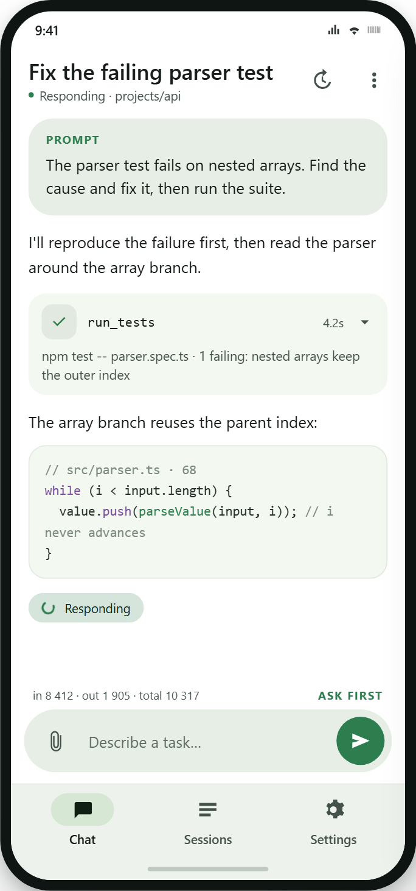
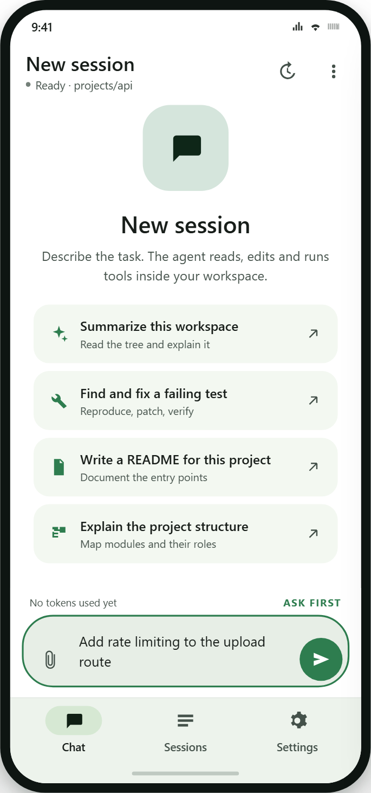
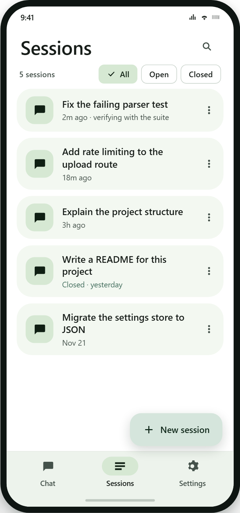
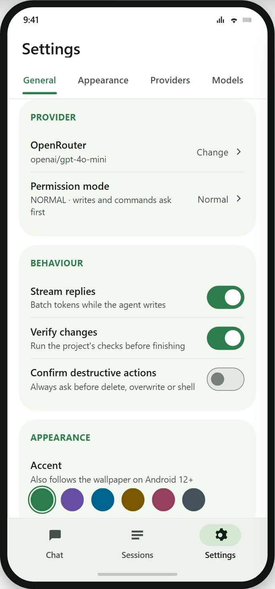

# Freenerf

Autonomous, multi-provider AI coding agent. It runs as a terminal UI — built
for Termux on Android, comfortable on Linux and macOS — and as a native Android
app powered by a Rust runtime.

Freenerf does not just chat. It plans work, calls tools, reads the results,
fixes its own mistakes, verifies what it changed, and reports an honest
outcome. It works directly inside a workspace you choose and never edits
outside it.

There are two front ends, and they share the same behaviour:

- **`freenerf`** — the Python agent and Textual TUI in `src/freenerf/`, installed
  with `pip`. This is the reference implementation.
- **The Android app(beta)** — Kotlin/Jetpack Compose UI over a Rust agent runtime in
  `native/`, built with Gradle and packaged as an APK.

## What it does

- **Autonomous execution loop** — investigate, plan, act, inspect, retry, verify,
  and finish with an explicit status: `completed`, `partial`, `failed`,
  `blocked`, `awaiting_approval` or `cancelled`.
- **Real coding tools** — list, read, inspect, search, edit, create and delete
  files (with backups), run shell commands, use Git, detect project tooling and
  run test verification.
- **Planning and task tracking** — the agent publishes a plan, updates each
  step with evidence, and stores tasks per session. Long-running shell commands
  can also run as background jobs whose output and status can be checked later.
- **Multiple providers** — OpenRouter, Google Gemini, FreeLLMAPI and any
  OpenAI-compatible endpoint, each with its own request/tool-calling format.
- **Workspace isolation** — sessions, tasks, images and backups are stored
  per workspace. Switching workspaces never mixes them.
- **Sessions** — create, rename, search, reopen and close conversations; each
  session keeps its own agent context.
- **Natural-language image generation** — “create a logo for my project” calls
  the FreeLLMAPI `/v1/images/generations` endpoint and saves the result in the
  workspace.
- **Web research** — search and read public pages (up to 4 MB each) for
  documentation and current facts, with URL safety checks.
- **Permissions and hard safety** — `DENIED` / `NORMAL` / `FULL`, enforced at
  the tool-execution layer, plus a non-overridable block on destructive
  commands.
- **A conversation-first terminal UI** — a multiline composer, session tabs,
  clear task progress, streamed Markdown replies, per-session activity and a
  mobile-friendly Settings Center. The FreeNerf signature palette and a fully
  editable custom palette sit alongside Textual's built-in themes.
- **Workflow shortcuts** — `@path/to/file` attaches a text file from the active
  workspace; `!command` runs shell through the permission system; `Alt+↑/↓`
  browses prompt history; `/export` saves the conversation as Markdown.

# What it actually have:

## Built-in toolset

The Python agent and Rust runtime share **22 built-in tools**. The Android host
adds four SSH tools when its remote-execution bridge is available (see
[Android app](#android-app)).

| Area | Tools |
| --- | --- |
| Workspace inspection | `list_files`, `read_file`, `file_info`, `search`, `project_info` |
| Workspace changes | `write_file`, `edit_file`, `delete_file` |
| Execution and verification | `run_shell`, `verify`, `git` |
| Web research | `web_search`, `web_fetch` |
| Image generation | `generate_image`, `image_create` (alias) |
| Plan tracking | `set_plan`, `update_step`, `finish` |
| Background processes | `task_start`, `task_status`, `task_list`, `task_stop` |

`task_start` launches a command without blocking the current agent turn and
returns a process ID. `task_status` returns its state and recent output,
`task_list` lists jobs for the active session, and `task_stop` stops a running
job. Up to eight jobs can run at once. Process records are stored with the
session; after a runtime restart, a formerly running process is marked
`unverified` rather than being reattached or controlled.

All tool calls pass through schema validation, timeouts and the permission
registry. In `NORMAL`, reads and task bookkeeping are allowed, image generation
is allowed inside the workspace, and writes or command execution require
approval (read-only Git operations are allowed). `DENIED` blocks tools; `FULL`
automatically permits operations other than the non-overridable destructive
command block.

## Repository layout

| Path | Contents |
| --- | --- |
| `src/freenerf/` | Python agent loop, tools, providers, workspaces, sessions and Textual TUI |
| `native/` | Rust workspace: agent loop, providers, tools, permissions, workspace, sessions, tasks, storage and the JNI crate |
| `android/` | Kotlin + Jetpack Compose app (Material 3 Expressive / Material You) that drives the Rust runtime |
| `tests/` | Python test suite |
| `docs/` | Architecture, tools, providers, workspaces, testing and Android documentation |

The terminal app and the Android app keep separate settings and data, because
one uses Python config files and the other Android Keystore and app-private
storage. The Android app can import an existing Python `config.json` and
legacy session/task databases once, from **Settings → Workspace**.

## Installation (terminal app)

Requires Python 3.11+.

### Termux (Python on Android)

```bash
pkg update
pkg install python ripgrep
termux-setup-storage        # if you want to work in shared storage

git clone https://github.com/TerikaCoder/freenerf
cd freenerf
python -m venv .venv
. .venv/bin/activate
pip install -e .
```

If `lxml` has no prebuilt wheel on your device:

```bash
pkg install libxml2 libxslt
pip install lxml
```

### Linux / macOS

```bash
git clone https://github.com/TerikaCoder/freenerf
cd freenerf
python3 -m venv .venv
. .venv/bin/activate
pip install -e ".[dev]"
```

### Run

```bash
freenerf
```

For the native Android app, see [Android app](#android-app) below.

The first launch asks for a workspace directory (the folder Freenerf is
allowed to edit) and stores it in the global config. If no API key is
configured yet the UI still opens; add one in **Settings → API Keys**
(`Ctrl+P`).

## Providers

| Provider | Key setting | Default model | Tools | Streaming |
| --- | --- | --- | --- | --- |
| OpenRouter | `openrouter_api_key` | `openai/gpt-4o-mini` | yes | yes |
| Google Gemini | `gemini_api_key` | `gemini-2.5-flash` | yes | no (falls back) |
| FreeLLMAPI | `freellmapi_api_key` | `auto` | yes | yes |
| OpenAI-compatible | `openai_api_key` | `gpt-4o-mini` | yes | yes |

Use **Model Explorer** (`Ctrl+O`, `/models`) to search each provider's catalog
with context size, pricing and tool capability, then activate a model.

Environment overrides (take precedence over the config file):

```bash
FREENERF_PROVIDER=gemini
FREENERF_MODEL=gemini-2.5-pro
FREENERF_GEMINI_API_KEY=...
FREENERF_OPENROUTER_API_KEY=...
FREENERF_FREELLMAPI_API_KEY=...
FREENERF_OPENAI_API_KEY=...
FREENERF_OPENAI_BASE_URL=http://127.0.0.1:1234/v1
FREENERF_WORKSPACE=/path/to/project
FREENERF_PERMISSION_MODE=normal
FREENERF_DATA_DIR=/path/to/central-data   # keep workspace data elsewhere
```

Configuration lives at `~/.config/freenerf/config.json` with `0600`
permissions. API keys are never stored in a workspace.

## Headless mode

```bash
freenerf --print "Find and fix the failing test, then run the suite" --yes
freenerf --workspace ~/projects/api --print "Summarise this repository"
freenerf --provider gemini --model gemini-2.5-pro --print "Review config.py"
freenerf --list-models
```

`--yes` auto-approves tool operations for that run (the hard safety block
still applies). Without it, operations that need approval are denied and
reported, so a script never silently performs destructive work.

Exit codes: `0` completed, `2` partial/awaiting approval, `3` failed/blocked,
/3w`130` cancelled.

## Keyboard shortcuts

| Key | Action |
| --- | --- |
| `Enter` | Insert a new line in the composer |
| `Ctrl+Enter` or **Send** | Send the prompt |
| `@` | Suggest and attach workspace files |
| `!command` | Run a shell command in the workspace |
| `Alt+↑` / `Alt+↓` | Browse prompt history |
| `/` | Slash-command suggestions |
| `Esc` | Cancel the running agent / close a dialog |
| `Ctrl+P` | Settings Center |
| `Ctrl+O` | Model Explorer |
| `Ctrl+N` | New session |
| `Ctrl+H` | Session history |
| `Ctrl+T` | Activity panel (opens as a mobile sheet on narrow terminals) |
| `Ctrl+B` | Show/hide task progress |
| `Ctrl+G` | Change workspace |
| `Tab` | Complete a slash command or file mention |
| `Ctrl+C` | Quit |

Slash commands: `/help`, `/new`, `/history`, `/models`, `/settings`,
`/config`, `/workspace`, `/permissions`, `/tasks`, `/bash`, `/theme`,
`/export`, `/clear`, `/exit`; aliases include `/resume`, `/sessions`,
`/themes`, `/quit` and `/theme:toggle`. `/clear` deletes the current transcript and
resets that session's agent context and clears its activity timeline; tasks remain
available in the task panel. Tool activity is restored when a session is reopened.
Use **Settings → Appearance → Theme Studio** to edit the custom palette.

## Permissions

- **DENIED** — no tool may run.
- **NORMAL** — read-only operations run; writes, deletions and commands ask
  for approval. This is the default.
- **FULL** — tool operations run automatically.

The hard safety block always rejects, in every mode: recursive deletion of
`/`, `~`, `..`, `.`, `*`, `.git` or `.freenerf`; filesystem formatting; raw
disk writes; shutdown/reboot; fork bombs; piping remote content into a shell;
and recursive permission changes on `/`.

Approval is evaluated in the tool registry, not in the UI, so no screen can
bypass it.

## Workspaces

A workspace owns an isolated `.freenerf/` directory containing:

```
.freenerf/
├── sessions.db     # conversations for this workspace
├── tasks.db        # plans, steps, logs and outcomes
├── images/         # generated images + history.json
├── backups/        # copies made before file edits/deletes
└── workspace.json
```

Changing workspace rebuilds the session and task databases, the agent and all
tools. Existing data in the previous workspace is left untouched. Unfinished
tasks are never run automatically; reopening a session offers to continue and
waits for approval.

Set `FREENERF_DATA_DIR` to keep the data outside the project (useful for
read-only project trees and shared storage).

## Verification and testing (terminal app)

```bash
python -m compileall -q src tests
PYTHONPATH=src python -m pytest tests -q
```

The suite covers configuration, workspace isolation, permissions and shell
safety, the tool registry, the agent loop (planning, retries, cancellation,
limits, plain-text fallback), providers and streaming, catalog routing, image
generation, sessions, task lifecycle, headless mode, the Textual UI and a real
HTTP multi-step tool-calling loop against a local fake server.

See [docs/TESTING.md](docs/TESTING.md) for details.

## Android app

A native Android client lives in [`android/`](android/) and the Rust agent
runtime it uses in [`native/`](native/). The Python CLI/TUI is unchanged; the
app reimplements the same agent loop, providers, tools, permissions, sessions
and tasks in Rust and drives them from Kotlin over JNI.

<p align="center">
  
  
  
  
</p>

Left to right: **Chat** during a run — the title's status line reads `Responding`
with the workspace, the tool card carries a status tile, the turn shows the
tonal `Responding` pill, and the composer puts token usage and the permission
mode on a meta row over a tonal field. **New session** — four suggestions with
an icon and a one-line hint, and the primary focus ring on the composer.
**Sessions** — a count and the All / Open / Closed filters above tonal cards
with 44 dp icon tiles. **Settings** — the nine categories as primary scrollable
tabs over grouped settings.

These are renders of [`android/ui-mockup.html`](android/ui-mockup.html), the
static HTML drawing of the Compose screens kept in step with the app; they are
not screenshots from a device.

What the app provides:

- A responsive Material 3 Expressive interface: phones use a bottom navigation
  bar, while wider screens use a navigation rail. The main sections are Chat,
  Sessions and Settings. Chat opens on a small app bar whose title sits above a
  status line — a colour dot plus `Ready` or the running turn, and the
  workspace name — that takes a tonal fill as the conversation scrolls under it.
  The look follows the Material You design system in
  [`material-you/`](material-you/) (the web front end's tokens, tool cards,
  composer and session list).
- Material You dynamic colour on Android 12+, plus Theme Studio with system,
  light and dark modes; six preset accents; a custom `#RRGGBB` accent that
  generates a complete palette; standard, medium and high contrast; and
  optional AMOLED-black surfaces.
- Streaming chat with a Markdown renderer for headings, lists, complete tables
  and copyable code blocks. A live turn shows a tonal "Responding" pill instead
  of a progress bar. Tool calls appear as expandable cards with their arguments,
  status and output, and each card carries a status tile — tonal while running,
  primary on success, error container on failure — with a chevron that rotates
  as the card opens. The composer puts token usage and the active permission
  mode on a meta row above the field, rings the tonal field in the primary
  colour while focused, supports file attachments and a stop/cancel control,
  and stays capped at 840 dp on tablets. Attached documents are copied
  into `.freenerf/uploads/` and their workspace-relative paths are included in
  the prompt; text files are the most useful attachment format for the agent.
- A render-optimized streaming path: tokens are coalesced before UI updates,
  only the completed Markdown prefix is parsed, inline spans are memoised, and
  scrolling follows new output only while the reader is already at the bottom.
- Session history with search and the same All / Open / Closed filters as the
  web list, plus rename, close, reopen and delete actions. New sessions are
  created when the first prompt is sent. Agent plans and task progress are
  shown inside the conversation; there is no separate Tasks tab.
- The same four providers and 22 built-in tools, with `DENIED` / `NORMAL` /
  `FULL` permissions and an in-app approval dialog. Four additional SSH tools
  are available through the Android remote-execution bridge.
- A nine-section Settings centre: General, Appearance, Providers, Models, API
  keys, Permissions, Workspace, SSH and About. On phones the categories are
  primary scrollable tabs under the app bar; wider screens use a side index. General settings include
  temperature, token/step limits, streaming and extra system instructions. The
  Models section loads the catalogs for all four providers and supports search
  and refresh; API keys are managed together in the Keys section.
- A workspace browser that can select folders under `/sdcard` (All files access
  is required on Android 11+) or choose a file and use its parent folder as the
  workspace. The app-private workspace is always available. SAF folder import
  and export copy files to/from the workspace, and legacy Python config and
  session/task databases can be imported from Settings → Workspace.
- An SSH client (JSch) with host, port, username, remote directory, password or
  private-key authentication, optional key passphrase and a connection test.
  Its `ssh_exec`, `ssh_read_file`, `ssh_write_file` and `ssh_list_files` tools
  route through the same permission policy as local tools.
- API keys and SSH credentials encrypted with an AES-256-GCM key from the
  Android Keystore and excluded from backups; secrets are not written to the
  Rust databases or logs.

The Android app targets API 36 and supports API 24+. Its Rust runtime has 82
passing tests, and the current JVM unit-test suite has 12 passing tests. The
debug APK builds with a real `libfreenerf.so`. The instrumented UI test compiles,
but it has not been run on a connected device or emulator; physical-device
launch and live provider requests have not been verified in this development
environment.

### Build the Android app

Requirements: JDK 17, Android SDK platform/build-tools 36, NDK 27.x, Rust with
the Android target installed, and Git Bash on Windows. The Gradle `preBuild`
task invokes the Rust cross-compilation script automatically.

```bash
# Install the default arm64 Rust target once
rustup target add aarch64-linux-android

cd android
./gradlew assembleDebug
```

The default APK ABI is `arm64-v8a`. To build for an arm64 device and an x86_64
emulator in the same APK:

```bash
./gradlew assembleDebug -PrustAbis=arm64-v8a,x86_64
```

The Rust build script also supports `armeabi-v7a` and Linux, macOS and Windows
build hosts. See [docs/ANDROID.md](docs/ANDROID.md) for the JNI architecture,
permissions, migration details and complete build instructions, and
[ANDROID_PORT_PROGRESS.md](ANDROID_PORT_PROGRESS.md) for current verification
status.

### Beta status

The Android client is still a work in progress. The native runtime, APK build
and JVM tests are verified, but on-device UI behaviour and live provider
requests still need testing. Please report reproducible issues in the GitHub
Issues tab.

## Documentation

- [Usage guide](INSTRUCTIONS.md)
- [Architecture](docs/ARCHITECTURE.md)
- [Tools and extension guide](docs/TOOLS.md)
- [Providers](docs/PROVIDERS.md)
- [Workspaces and data](docs/WORKSPACES.md)
- [Testing](docs/TESTING.md)
- [Troubleshooting](docs/TROUBLESHOOTING.md)
- [Android app](docs/ANDROID.md) and [port progress](ANDROID_PORT_PROGRESS.md)

## Known limitations

- The safety policy inspects commands before execution; it is a strong guard
  against common destructive mistakes, not an OS sandbox. Shell commands run
  with your user's permissions.
- Web fetch resolves DNS twice; a deliberately rebinding hostname could still
  reach a private address. Treat fetched content as untrusted.
- Gemini does not stream in this implementation; replies arrive complete.
- Terminals cannot display images inline, so generated images are saved in the
  workspace and their paths are reported.
- Freenerf cannot change the Termux terminal font; use pinch-to-zoom. XFCE
  terminal font changes are supported.
- The TUI is designed for Textual 1.0+ and is tested with the current Textual
  release; very old terminals without true color lose some styling but remain
  usable.
- The Android debug APK contains only `arm64-v8a` by default; other ABIs need
  an explicit build flag.
- The Android app can use a shared-storage folder as its workspace, but that
  needs All files access. SAF import/export still copies folders in and out
  rather than mounting them. SSH requires a reachable host and either a
  password or a private key.
- The Android app is still in development, and its not the final product. Be patient for the final one.

## License

No license file is included in this repository yet.
